# Azure Cloud Security Hands-On Lab

> Hardening a Microsoft Azure environment end-to-end: least-privilege IAM, network lockdown, storage protection, policy guardrails, and threat detection with Defender for Cloud + Log Analytics.

- **Date:** July 31, 2026
- **Platform:** Microsoft Azure

---

## Table of Contents

- [Lab Architecture](#lab-architecture)
- [Tools and Services Used](#tools-and-services-used)
- [1. Prerequisites and Environment Setup](#1-prerequisites-and-environment-setup)
- [2. Identity and Access Management (IAM)](#2-identity-and-access-management-iam)
- [3. Network Security](#3-network-security)
- [4. Storage Hardening and Data Protection](#4-storage-hardening-and-data-protection)
- [5. Policy Enforcement and Compliance (Governance)](#5-policy-enforcement-and-compliance-governance)
- [6. Threat Detection and Monitoring](#6-threat-detection-and-monitoring)
- [7. Security Recommendations](#7-security-recommendations)
- [Key Takeaways](#key-takeaways)

---

## Lab Architecture

Everything in the lab lives under a single dedicated resource group, with identity controls enforced at sign-in, guardrails at deployment time, and monitoring wired into a Log Analytics workspace.

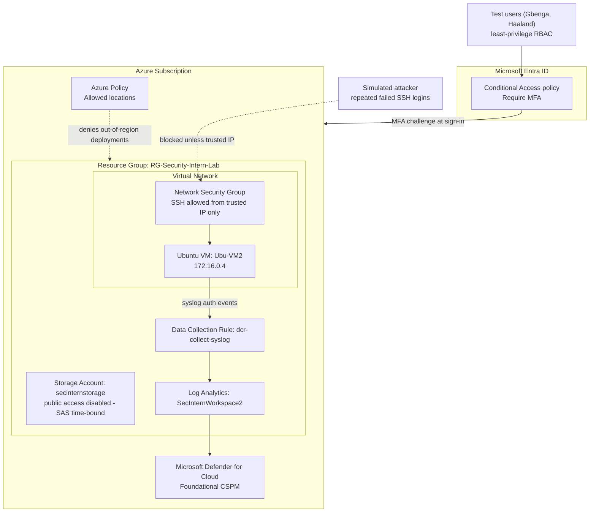

## Tools and Services Used

| Area | Service / Tool |
|------|----------------|
| **Cloud Platform** | Microsoft Azure (dedicated lab subscription) |
| **Identity** | Microsoft Entra ID, RBAC, Conditional Access, MFA |
| **Compute / Network** | Ubuntu 24.04 LTS VM, Virtual Network (VNet), Network Security Group (NSG) |
| **Storage** | Azure Blob Storage, Shared Access Signatures (SAS) |
| **Governance** | Azure Policy |
| **Monitoring** | Log Analytics workspace, Data Collection Rules, KQL, Microsoft Defender for Cloud (CSPM) |

---

## 1. Prerequisites and Environment Setup

**Objective:** Establish the foundational Azure environment before starting the security tasks.

### Walkthrough

- Verified an **active Azure subscription** was linked to the account by navigating to *Subscriptions* on the Azure home page and checking for an active status.

  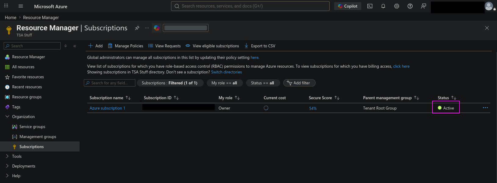

- Created a dedicated resource group, **`RG-Security-Intern-Lab`**, to house all project resources.

  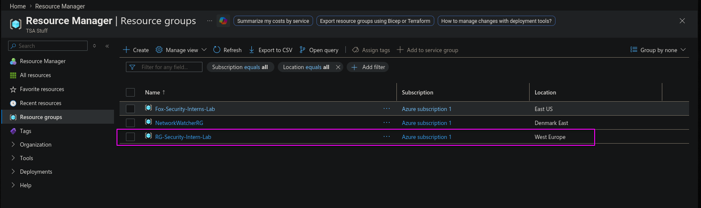

- Ran a **permissions check** to confirm the account had sufficient privileges (**Owner/Contributor** and **User Access Administrator**) at the subscription level to deploy resources, manage Microsoft Entra ID, and assign RBAC roles.

  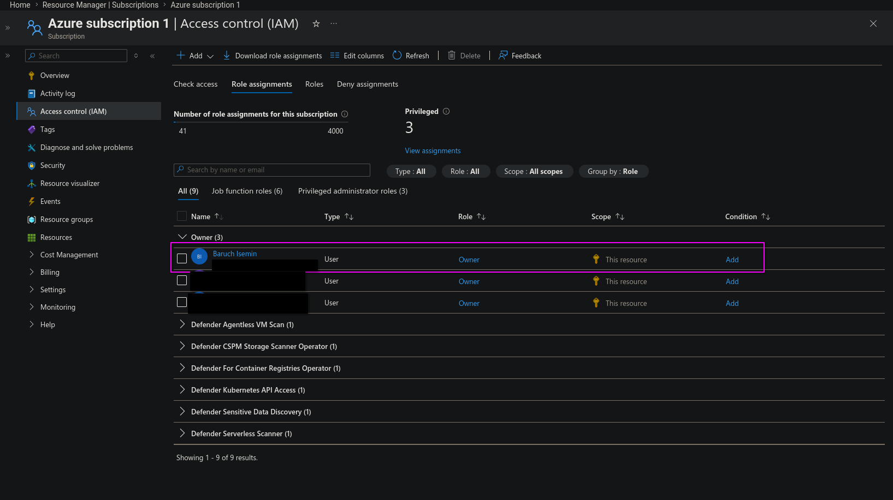

---

## 2. Identity and Access Management (IAM)

**Objective:** Implement a least-privilege access model using Role-Based Access Control (RBAC) and enforce Multi-Factor Authentication (MFA).

### Walkthrough

- Created test user profiles (**Gbenga** and **Haaland**) in Microsoft Entra ID.
- Assigned **strict RBAC roles at the resource group level** to limit unnecessary permissions:

  | Test user | Resource group scope | Effective access |
  |-----------|----------------------|------------------|
  | Gbenga | Storage resources | Limited storage access only |
  | Haaland | Virtual machines | Read-only VM access |

  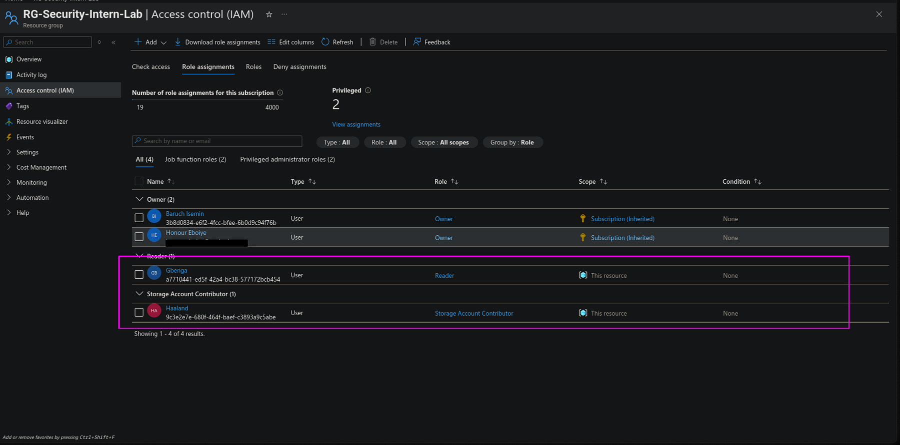

- Configured **Conditional Access policies** to enforce MFA challenges at user sign-in. First sign-in triggered the enrollment prompt:

  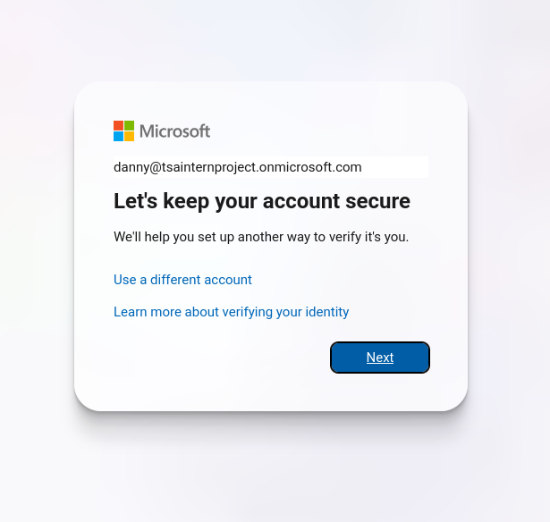

  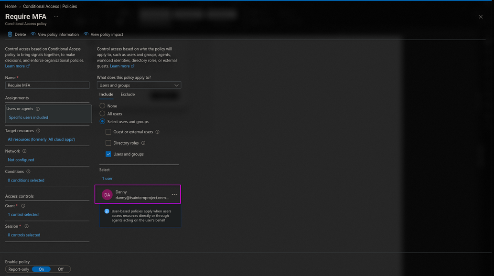

---

## 3. Network Security

**Objective:** Deploy a VM and secure its network perimeter by restricting inbound access strictly to a trusted IP address.

### Walkthrough

- Provisioned a basic **Ubuntu Linux VM** (`Ubu-VM2`) inside a dedicated Azure Virtual Network.

  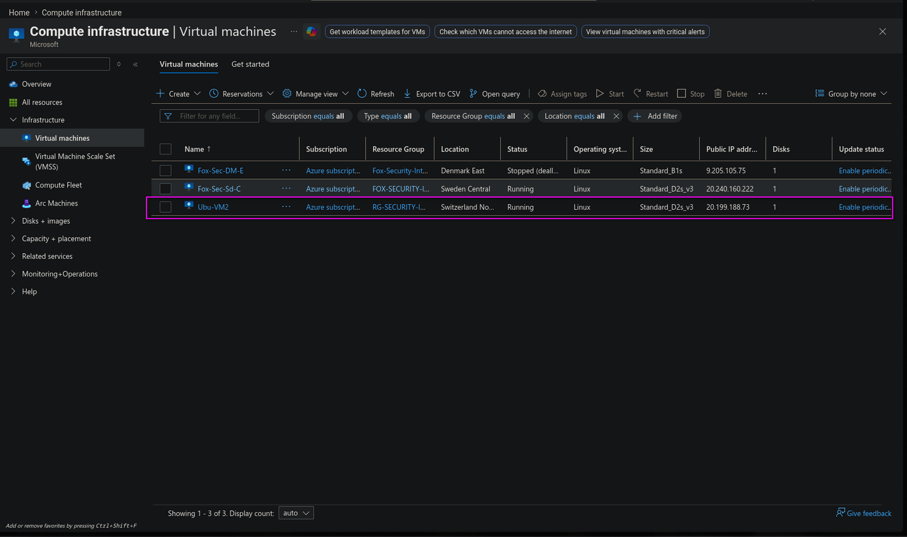

- Configured the **Network Security Group (NSG)** by **removing the default inbound rule for port 22 (SSH)**, then created a custom inbound rule allowing traffic **only from my trusted IP address** — denying all other inbound traffic by default.

  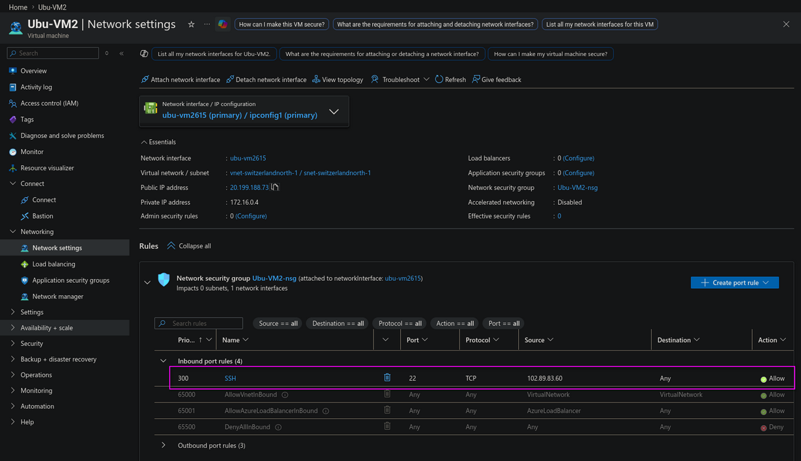

### Proof It Works

The result is a strict deny-by-default perimeter:

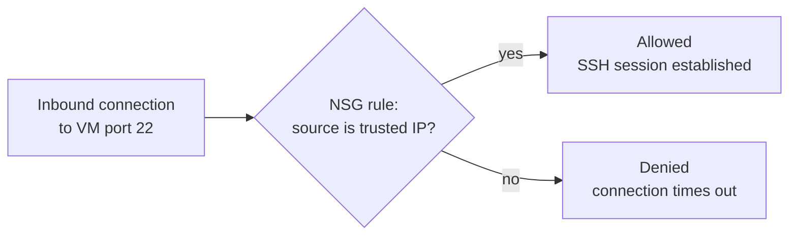

An SSH attempt from a non-allowed source **times out** — the port is invisible, not just closed:

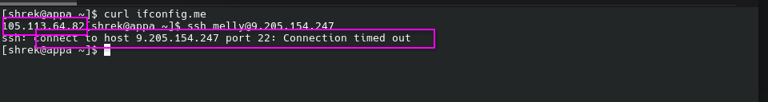

From the trusted IP (confirmed via `curl ifconfig.me`), the **same SSH attempt succeeds**:

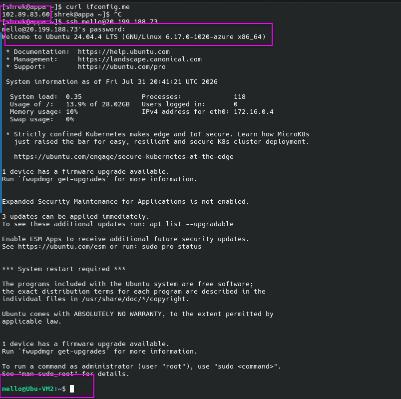

---

## 4. Storage Hardening and Data Protection

**Objective:** Secure an Azure Storage Account by disabling public access, verifying encryption at rest, and generating a secure, time-bound token for access.

### Walkthrough

- Created an Azure Storage Account (`secinternstorage`) with a **Blob container**.

  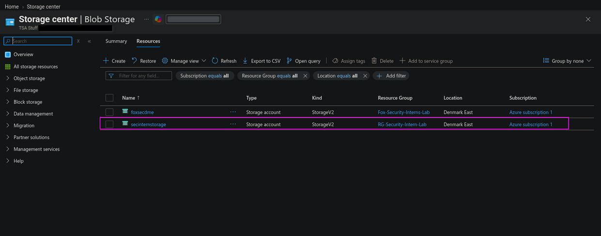

- Modified the configuration to **explicitly disable anonymous/public access** on the storage account.

  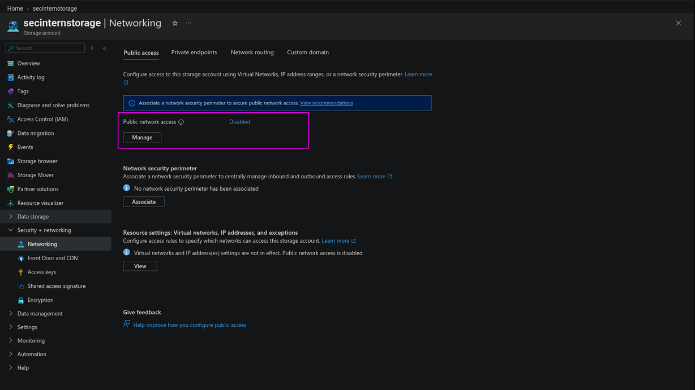

- Verified **Microsoft-managed encryption keys** were active for data at rest.

  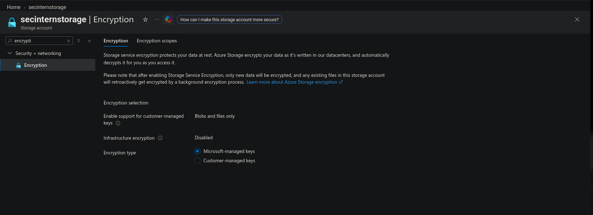

- Generated a **Shared Access Signature (SAS)** token for time-bound, restricted access.

  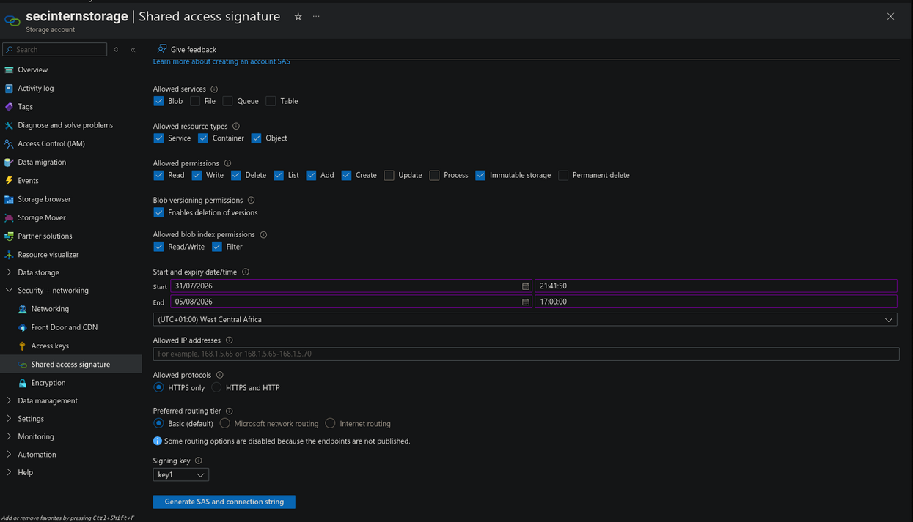

### Security Context: SAS Tokens vs. Primary Keys

Shared Access Signatures are fundamentally more secure than primary access keys because they enforce the **principle of least privilege**:

| | SAS Token | Primary Access Key |
|---|-----------|--------------------|
| **Scope** | Granular — specific service, resource type, permissions | Entire storage account |
| **Lifetime** | Time-bound (starts/expires) | Permanent until manually rotated |
| **Revocability** | Expires automatically; tied to account key rotation | Rotating it invalidates every dependent service |
| **Blast radius** | Reduced attack surface | Acts as a master password — unrestricted administrative control |

The lab token (signature redacted; it has since expired):

```
https://secinternstorage.blob.core.windows.net/?sv=2026-02-06&ss=b&srt=sco&sp=rwdlacitfx&se=2026-08-05T16:00:00Z&st=2026-07-31T20:41:50Z&spr=https&sig=***REDACTED***
```

> **Lesson learned:** the lab token was generated with broad permissions (`sp=rwdlacitfx`). In production, a token like this should be scoped down to read-only (`sp=r`) with the shortest practical expiry — least privilege applies to tokens too.

---

## 5. Policy Enforcement and Compliance (Governance)

**Objective:** Automate security guardrails using Azure Policy to enforce infrastructure compliance rules.

### Walkthrough

- Applied the **"Allowed locations"** policy definition to restrict resource deployments to specific geographic regions.

  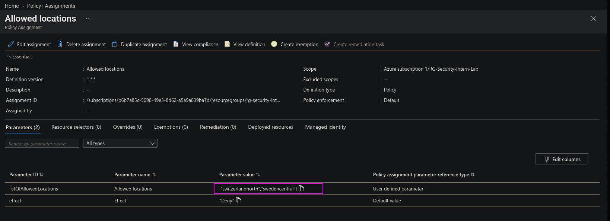

- **Intentionally violated the rule** by attempting to deploy a resource in an unauthorized region, to trigger and verify the automatic block.

  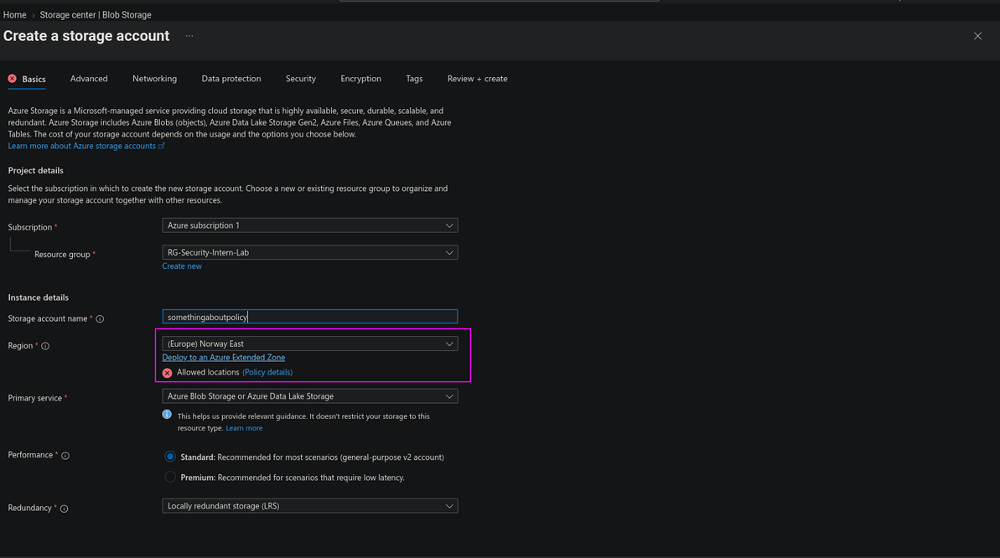

- Result: the deployment is **denied automatically by policy** — no manual policing required. Guardrails enforce compliance at deployment time, before a misconfigured resource can ever exist.

---

## 6. Threat Detection and Monitoring

**Objective:** Enable security monitoring to detect anomalies and track down logs for a simulated incident.

### Walkthrough

- Created a **Log Analytics workspace** (`SecInternWorkspace2`) and linked it to the Linux VM to capture security events.

  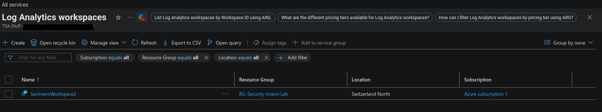

- Enabled **Cloud Security Posture Management (CSPM)** via Microsoft Defender for Cloud.

  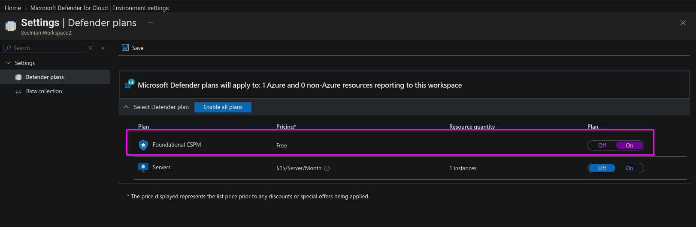

- Created a **Data Collection Rule** (`dcr-collect-syslog`) to send logs from the VM into `SecInternWorkspace2`.

  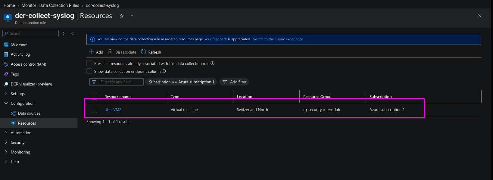

### Simulated Incident: SSH Brute-Force

Simulated an incident by **intentionally failing SSH logins multiple times** (as user `mitnick` — a nod to Kevin Mitnick) to generate authentication logs:

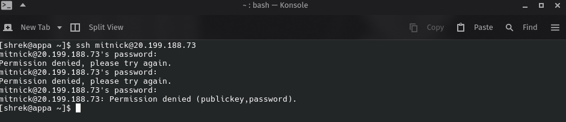

The resulting detection pipeline:

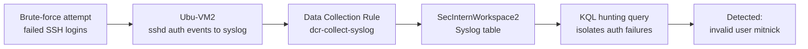

### Hunting with KQL

Used **Kusto Query Language (KQL)** to parse the `Syslog` table and isolate the exact authentication failure events:

```kql
Syslog
| where (Facility == 'authpriv' and SyslogMessage has 'sshd:auth' and SyslogMessage has 'authentication failure') or (Facility == 'auth' and ((SyslogMessage has 'Failed'
and SyslogMessage has 'invalid user' and SyslogMessage has 'ssh2') or SyslogMessage has 'error: PAM: Authentication failure'))
```

The query surfaced the failed login attempts with full context — source IP, port, and username included:

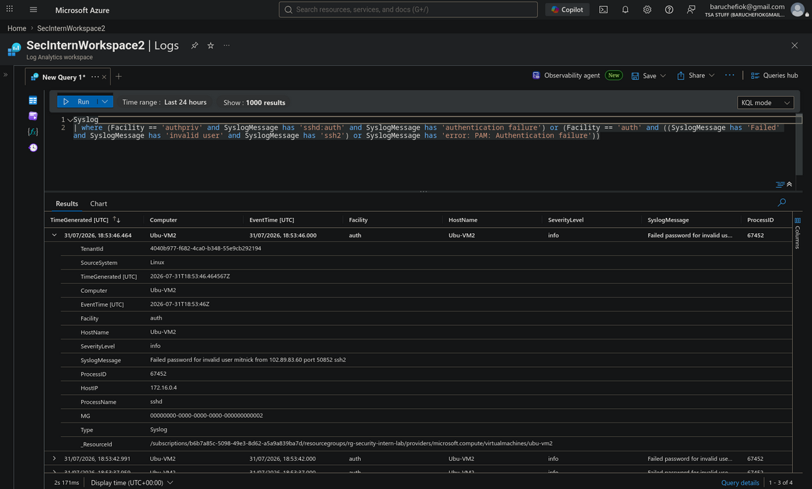

| TimeGenerated | Computer | Facility | SyslogMessage |
|---------------|----------|----------|---------------|
| 31/07/2026 18:53:46 | Ubu-VM2 | auth | `Failed password for invalid user mitnick from 102.89.83.60 port 50852 ssh2` |

---

## 7. Security Recommendations

Based on the Microsoft Defender for Cloud CSPM scan, the following actions are prioritized for this environment:

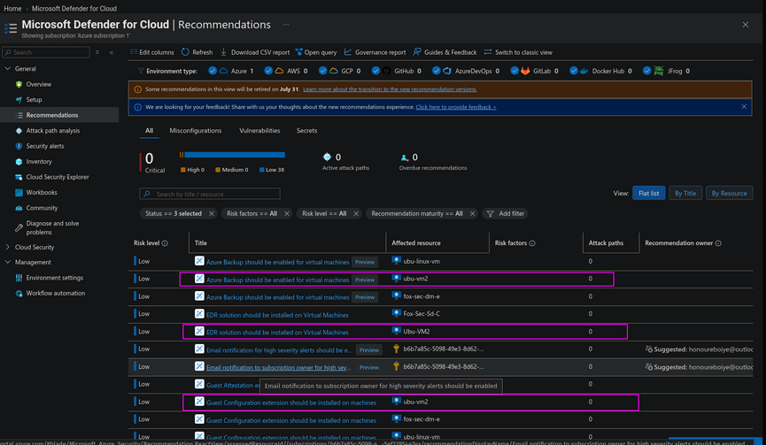

| Priority | Finding (Defender CSPM) | Recommended Action | Why It Matters |
|----------|--------------------------|--------------------|----------------|
| 1 | Azure Backup should be enabled for virtual machines | Enable Azure Backup with a recovery vault for `Ubu-VM2` | Protects against data loss from ransomware, accidental deletion, or corruption |
| 2 | An EDR solution should be installed on virtual machines | Onboard the VM to Microsoft Defender for Servers (EDR) | Detects and blocks endpoint threats beyond what network logs can see |

---

## Key Takeaways

- **Least privilege everywhere**: scoped RBAC roles, MFA enforcement, and SAS tokens over master keys all shrink the blast radius of a compromised identity.
- **Deny-by-default networking**: removing the default SSH rule and allowlisting a single trusted IP makes the VM invisible to the rest of the internet, and the blocked/allowed tests prove the perimeter works.
- **Guardrails beat manual review**: Azure Policy blocks non-compliant deployments automatically, before a misconfigured resource can ever exist.
- **You can't protect what you can't see**: wiring the VM into Log Analytics via a Data Collection Rule turned a simulated brute-force attack into a queryable event in seconds, with KQL providing the hunting capability.
- **Posture management is continuous**: Defender for Cloud CSPM converts the environment's weaknesses into a prioritized, actionable backlog.

---

<br>

<div align="center"><strong>🤍 Baruch (and few cups of coffee ☕)</strong></div>
